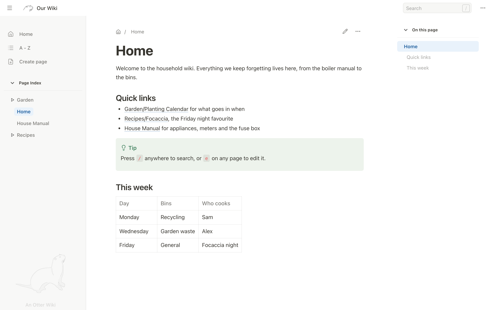
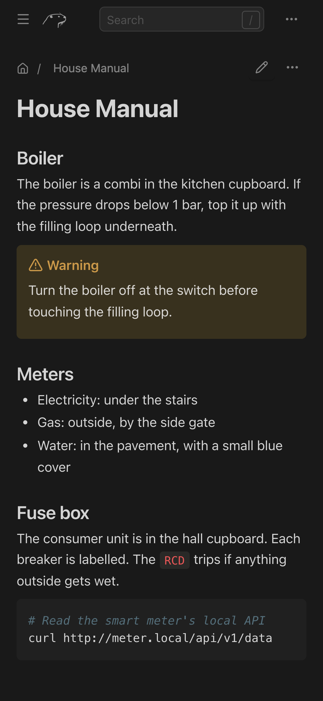
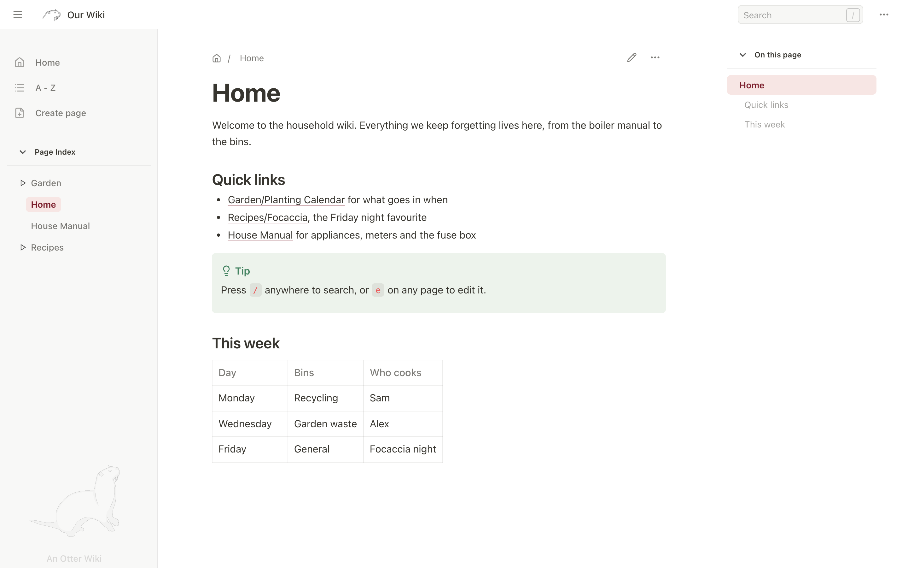

# Holt

Holt is a Notion-style theme for [An Otter Wiki](https://otterwiki.com). It gives Otter Wiki a calm
reading column, quiet controls, Lucide icons and a search box that finds pages as you type. It's
two files dropped into Otter Wiki's `custom` folder, with no changes to Otter Wiki itself.

A holt is an otter's den.



| Before | After |
| --- | --- |
|  |  |

## What it changes

- **Reading.** Pages sit in a centred column with Notion's type sizes, warm text, soft tables and
  tinted callouts. Long code and tables scroll inside themselves instead of widening the page.
- **Page bar.** Edit and the page menu (attachments, history, blame, rename and delete) move out of
  the top bar into a row beside the breadcrumbs, where Notion and Confluence put them. Edit is a
  quiet pencil, and `e` still opens the editor.
- **Search as you type.** The search box lists matching pages and headings straight away, then
  matches in page text a moment later. Arrow keys and Enter work, and the last row opens Otter
  Wiki's full search.
- **Outline.** "On this page" highlights the section you're reading, keeps a clicked section
  highlighted, and on phones closes the sidebar once you pick one.
- **Icons.** Every Font Awesome icon Otter Wiki draws is replaced with its
  [Lucide](https://lucide.dev) outline equivalent.
- **Otter Wiki's own pages.** History, changelog, blame, diffs, search results, the A–Z index and
  the forms for creating, renaming and deleting pages, settings and login all match the theme.
  Diffs use GitHub's colours, and on phones blame puts each commit above its lines.
- **Dark mode and phones.** Everything has a dark version, and every page is checked at phone width.


| Dark mode | Page menu |
| --- | --- |
|  |  |

| Phone | Phone, dark mode |
| --- | --- |
|  |  |

## Installing

Holt needs Otter Wiki 2.27.0. It may work on other versions, but see
[Compatibility](#compatibility).

Otter Wiki loads `custom.css` and `custom.js` from `/app/otterwiki/static/custom` in its container.
Clone this repository and mount its `custom` folder there. With Docker Compose:

```yaml
services:
  otterwiki:
    image: redimp/otterwiki:2.27.0
    volumes:
      - ./app-data:/app-data
      - ./otterwiki-holt/custom:/app/otterwiki/static/custom:ro
```

If you already have a `custom` folder, copy `custom/custom.css` and `custom/custom.js` into it
instead. Otter Wiki serves them straight from disk, so there's no need to restart it.

### Browser caching

Otter Wiki links `custom.css` and `custom.js` without a version in the URL, so browsers can keep
an old copy for hours after you change them. Safari on iOS is the worst for this, and has no hard
refresh. If changes don't show up, clear the site's data in the browser.

To fix it for good, have your reverse proxy tell browsers to check for a new copy on every load.
When nothing has changed, the check is a tiny "not modified" reply. With nginx:

```nginx
location /static/custom/ {
    proxy_pass http://127.0.0.1:8080;
    add_header Cache-Control "no-cache" always;
}
```

With Caddy:

```caddy
wiki.example.com {
    header /static/custom/* Cache-Control "no-cache"
    reverse_proxy 127.0.0.1:8080
}
```

## Colours

The default accent is a soft Notion blue. A rose palette, blush and rose with maroon text, is
included too. To use a palette from `palettes/`, add it to the end of `custom.css`:

```bash
cat otterwiki-holt/palettes/rose.css >> otterwiki-holt/custom/custom.css
```



To make your own, copy `palettes/rose.css` and change its colours. There are three accent colours,
which are used in both light and dark mode:

- `--holt-accent-light` fills main buttons, like Save.
- `--holt-accent-mid` is their hover colour, the focus ring, and the accent in dark mode.
- `--holt-accent-dark` is the text on main buttons and the accent in light mode.

The rest are the selected sidebar item (`--holt-selected-bg`), selected text (`--holt-selection`),
the focus ring (`--holt-accent-ring`) and link underlines (`--holt-link-underline`). Each one has a
light and a dark value.

Every other colour, like text, callouts and diffs, is a `--holt-*` variable near the top of
`custom.css`, if you want to change those too.

## Compatibility

Holt is tested on Otter Wiki 2.27.0, in Chrome on desktop and phone widths and in Safari on iOS. It
uses modern CSS such as `:has()`, so it needs a browser from 2024 or later.

Most of it is CSS over Otter Wiki's own variables and classes, which changes little between
releases. Some of it depends on Otter Wiki's HTML, and a release could break those parts:

- The page bar moves Otter Wiki's Edit button and the page tools at the top of its menu. If the
  menu changes, the tools stay where they were.
- Search as you type reads page and heading names from the A–Z index at `/-/index`, and page text
  from Otter Wiki's `/-/search`. Both are read from their HTML.
- The styling of history, blame, the forms and the other built-in pages assumes their current
  layout.
- A new Font Awesome icon in an Otter Wiki release keeps its old look until it's added to the map
  in `custom.css`.

Please open an issue if something breaks on a newer Otter Wiki.

## Privacy

The Lucide icons load from [jsDelivr](https://www.jsdelivr.com) at a pinned version, so a viewer's
browser fetches them from jsDelivr's servers. Nothing else leaves your wiki. To serve the icons
yourself, download the SVGs from [`lucide-static`](https://www.npmjs.com/package/lucide-static) and
change the URLs in `custom.css` to point at your copies.

## Licence

MIT. See [LICENSE](LICENSE). Lucide is under the ISC licence.
