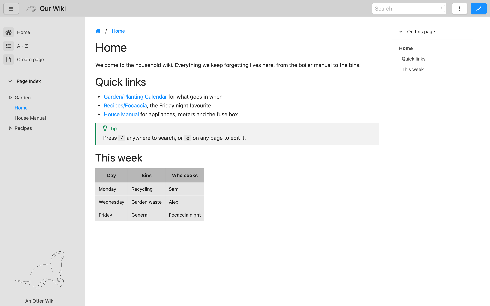
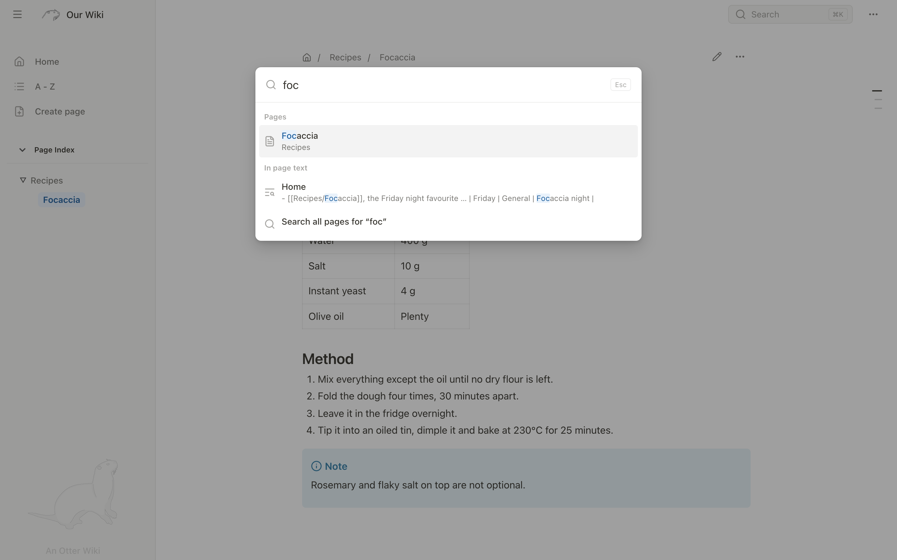
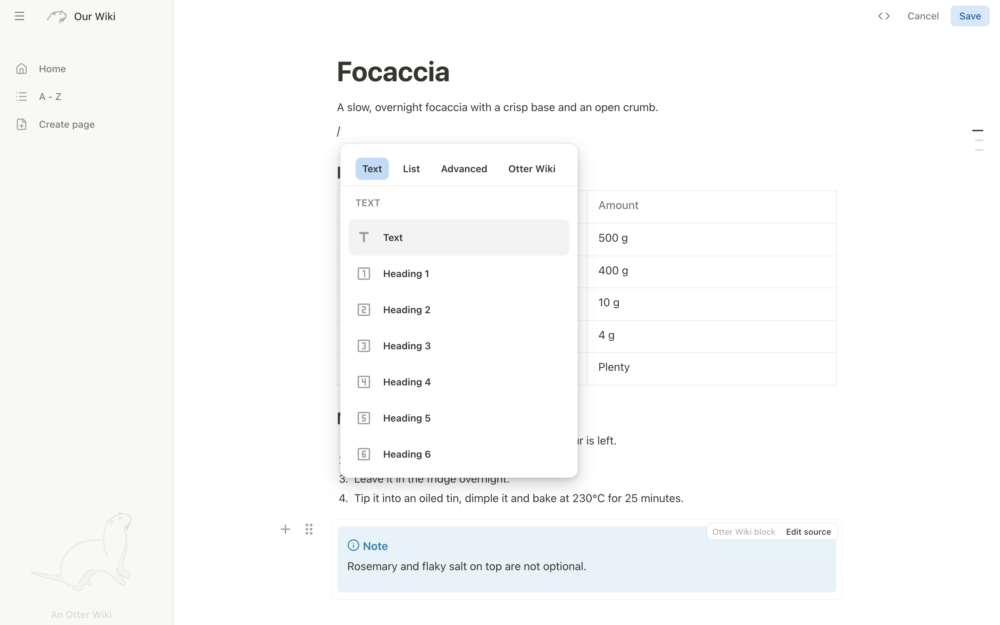
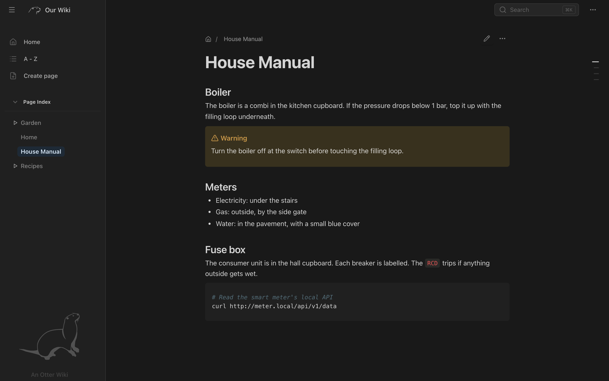
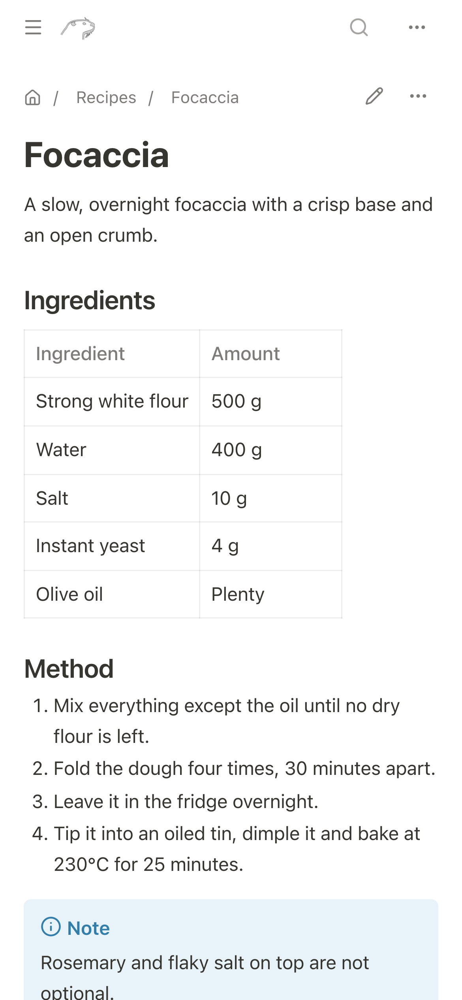

# Holt

Holt is a Notion-style theme for [An Otter Wiki](https://otterwiki.com). You add it through two
Otter Wiki settings, and Otter Wiki itself stays as it is.

A holt is an otter's den.


| Before | After |
| --- | --- |
|  |  |

## Features

- A centred reading column with Notion's type sizes, warm text, soft tables and tinted callouts.
- A search dialog, opened with `/` or ⌘K, that finds pages and headings as you type.
- A floating outline at the page's right edge on wide screens.
- Edit and the page menu beside the breadcrumbs, with a Full width switch for each page.
- A rich text editor with Notion's `/` menu, block handles and `[[` page links. It only opens pages
  it can save without changing them, and the Markdown editor is always available.
- [Lucide](https://lucide.dev) icons, embedded in the stylesheet.
- Matching history, blame, diffs, search results, settings and forms.
- Dark mode, and every page checked at phone width.
- Accent colours you can [change](docs/customising.md) from your `custom.css`.

The [feature guide](docs/features.md) and the [rich text editor guide](docs/rich-text-editor.md)
explain each one in more detail.

| Search | Rich text editor |
| --- | --- |
|  |  |

| Dark mode | Phone |
| --- | --- |
|  |  |

## Installing

Holt needs Otter Wiki 2.27.0. It may work on other versions, but see
[Compatibility](docs/compatibility.md).

Otter Wiki's `HTML_EXTRA_HEAD` and `HTML_EXTRA_BODY` settings add HTML to every page, and Holt uses
them to load `holt.css` and `holt.js`. On edit pages, `holt.js` also loads the rich text editor's
files, `holt-editor.js`, `holt-editor.css` and `holt-emoji.json`, from the same place it was loaded
from.

### From jsDelivr

[jsDelivr](https://www.jsdelivr.com) serves each tagged release of this repository. Add the two
settings to Otter Wiki's environment. With Docker Compose:

```yaml
services:
  otterwiki:
    image: redimp/otterwiki:2.27.0
    environment:
      HTML_EXTRA_HEAD: '<link rel="stylesheet" href="https://cdn.jsdelivr.net/gh/ryan-jan/otterwiki-holt@v0.3.0/holt.css">'
      HTML_EXTRA_BODY: '<script src="https://cdn.jsdelivr.net/gh/ryan-jan/otterwiki-holt@v0.3.0/holt.js"></script>'
```

To upgrade, change the version in both URLs. Each release has its own URL, so browsers can't show
a stale copy.

Each viewer's browser fetches the files from jsDelivr. If jsDelivr can't be reached, the wiki still
works, with Otter Wiki's default look and editor.

### Self-hosted

Download `holt.css`, `holt.js`, `holt-editor.js`, `holt-editor.css` and `holt-emoji.json` from a
[release](https://github.com/ryan-jan/otterwiki-holt/releases). Put them in a folder mounted at
`/app/otterwiki/static/custom`, which is where Otter Wiki keeps its `custom.css` and `custom.js`.
Then point the two settings at them:

```yaml
services:
  otterwiki:
    image: redimp/otterwiki:2.27.0
    volumes:
      - ./custom:/app/otterwiki/static/custom:ro
    environment:
      HTML_EXTRA_HEAD: '<link rel="stylesheet" href="/static/custom/holt.css?v=0.3.0">'
      HTML_EXTRA_BODY: '<script src="/static/custom/holt.js?v=0.3.0"></script>'
```

Otter Wiki ignores the `?v=`, but browsers treat it as part of the address. Change it when you
upgrade, so they fetch the new files. Holt passes it on to the editor's files too. Nothing in Holt
contacts any other server.

## Documentation

- [Features](docs/features.md)
- [Rich text editor](docs/rich-text-editor.md), including how to turn it off
- [Customising](docs/customising.md) the colours, and keeping browsers from caching old ones
- [Compatibility](docs/compatibility.md) with Otter Wiki versions and browsers
- [Development](docs/development.md), for building the editor, updating icons and releasing

## Licence

MIT. See [LICENSE](LICENSE). The embedded [Lucide](https://lucide.dev) icons are under the ISC
licence. See [LICENSE-lucide](LICENSE-lucide). The rich text editor bundles Milkdown, ProseMirror
and other open source libraries, whose licences are listed in `holt-editor.js.LEGAL.txt`.
