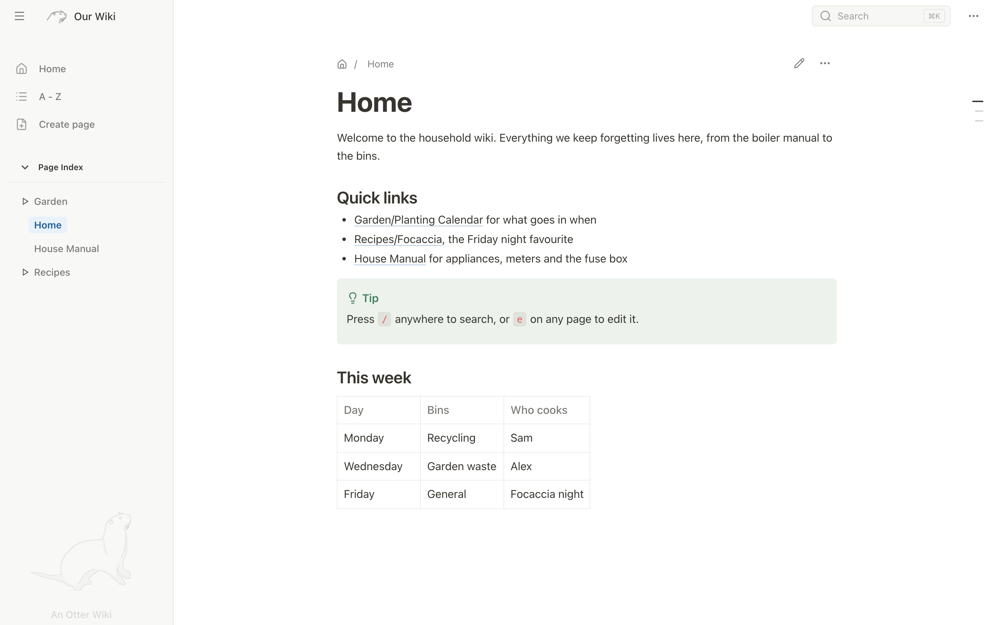
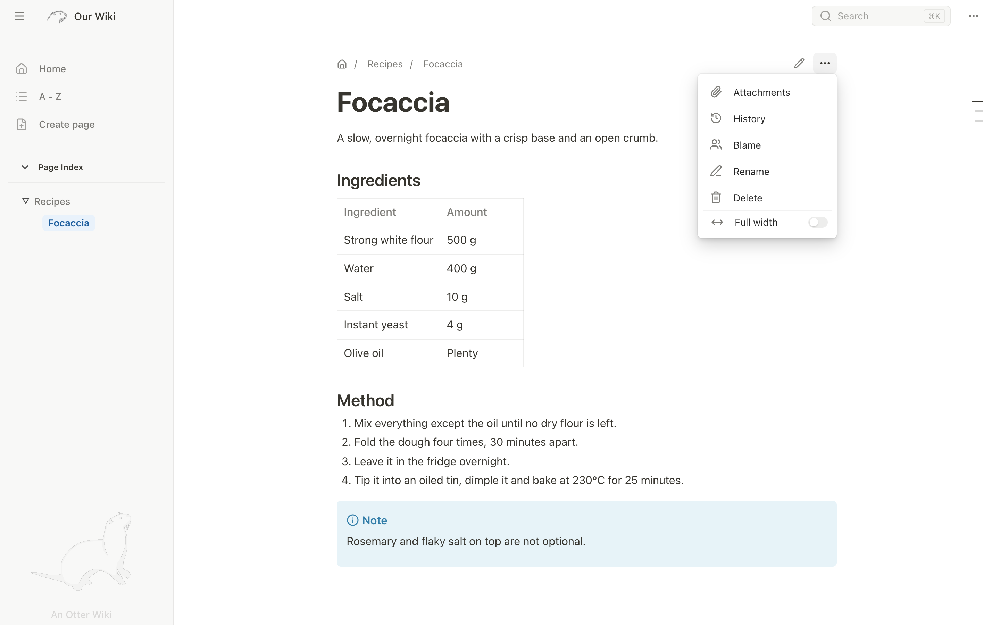
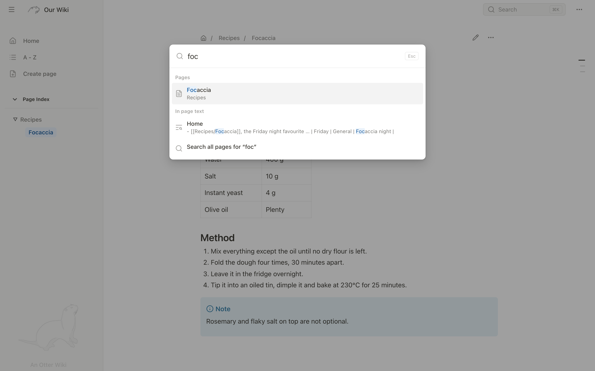
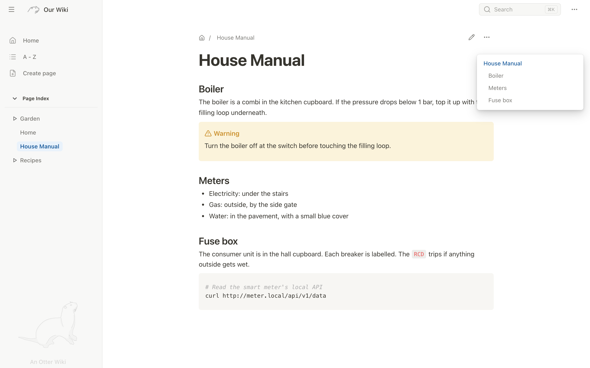
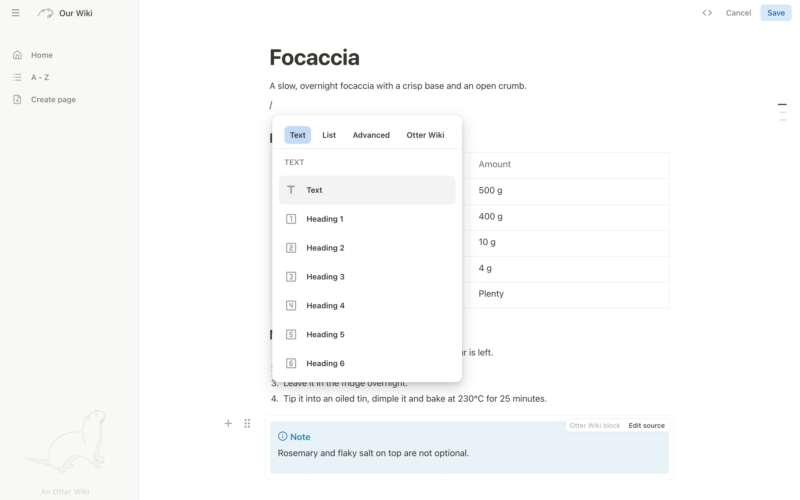
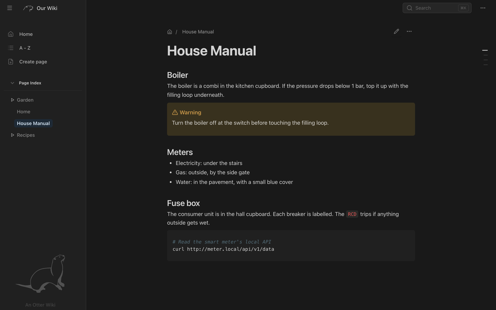
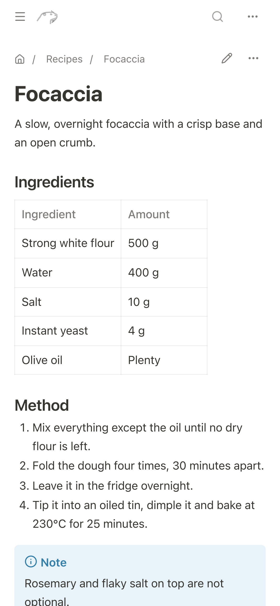
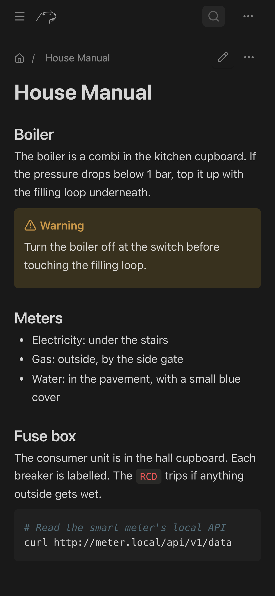

# Features

## Reading

Pages sit in a centred column with Notion's type sizes, warm text, soft tables and tinted callouts.
Long code and tables scroll inside themselves, so the column keeps its width. Icons come from
[Lucide](https://lucide.dev), a consistent outline set. They're embedded in the stylesheet as SVGs,
so they load with it, stay sharp at any size and take the colour of the text around them.

## Page bar and full width

Edit and the page menu sit in a row beside the breadcrumbs. Edit is a pencil icon, and `e` opens
the editor too. The menu holds attachments, history, blame, rename and delete, and a Full width
switch, which is remembered per page in each browser.

## Search

Search opens in a centred dialog. Click the search button, or press `/` or ⌘K (Ctrl+K elsewhere).
It lists matching pages and headings as you type, then matches in page text a moment later. Arrow
keys and Enter work, and the last row opens a full search.

## Outline

On wide screens the outline floats at the page's right edge as a short line per heading, and it
opens into the full outline on hover. It highlights the section you're reading and keeps a clicked
section highlighted. On smaller screens the outline is in the sidebar, which closes on phones once
you pick a section.

## Rich text editor

The editor opens in a rich text mode built on [Milkdown](https://milkdown.dev), with Notion's `/`
menu, block handles and `[[` page links. You can switch to the Markdown editor at any time. See
[Rich text editor](rich-text-editor.md).

## Built-in pages, dark mode and phones

History, changelog, blame, diffs, search results, the A-Z index, settings, login and the forms for
creating, renaming and deleting pages all match the theme. Diffs use GitHub's colours, and on
phones blame puts each commit above its lines. Everything has a dark version, and every page is
checked at phone width.

| Dark mode | Phone | Phone, dark mode |
| --- | --- | --- |
|  |  |  |
