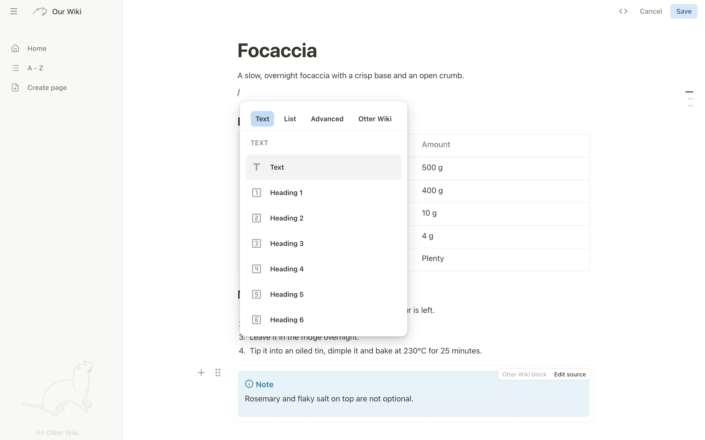

# Rich text editor

The editor opens in rich text mode, with the page in its reading column and Holt's typography, so
it looks as it will once saved. It works much like Notion's editor.

- Type `/` for headings, lists, quotes, tables, code, emoji, wiki links and Otter Wiki's own blocks.
- Hover over a block for its handle. Click `+` to add a block below, or Option-click (Alt-click
  elsewhere) to add one above. Drag `⋮⋮` to move the block, or click it to turn the block into
  another kind, duplicate it or delete it.
- Type `[[` to link to a page, picked from the wiki's pages as you type.
- Select text for bold, italic, links, highlight and the other formatting.
- On wide screens the floating outline follows the headings as you edit them.



## Markdown mode

The `</>` button beside Save switches to the Markdown editor, and the wand switches back. Holt
remembers which you prefer, in each browser. Markdown mode has the preview buttons and the
attachment and wiki link panels. Rich mode shows the page as it will look, and adds links and images
from the `/` menu.

## How it keeps pages safe

The page's Markdown is always the master copy. The rich editor keeps it up to date as you type, so
saving, drafts and attachments all work from the Markdown.

A page only opens in rich mode if Otter Wiki renders it exactly the same after a round trip through
the rich editor, so the editor can't change a page you didn't edit. Any other page opens in Markdown
mode, and the wand explains why. Info boxes, alerts, maths and the rest of Otter Wiki's syntax show
as they'll render, and their source opens in place to edit.

Once you change something, the rich editor writes out the whole page in its own style. The page
renders the same, but some Markdown may be laid out differently, such as padded table columns, so
the diff can include lines you didn't touch.

## Turning it off

The editor is about 850 KB, or 270 KB compressed, and only edit pages load it. The emoji data loads
the first time the emoji picker opens. To use only the Markdown editor, add `data-editor="off"` to
Holt's script tag:

```yaml
      HTML_EXTRA_BODY: '<script src="https://cdn.jsdelivr.net/gh/ryan-jan/otterwiki-holt@v0.3.0/holt.js" data-editor="off"></script>'
```
